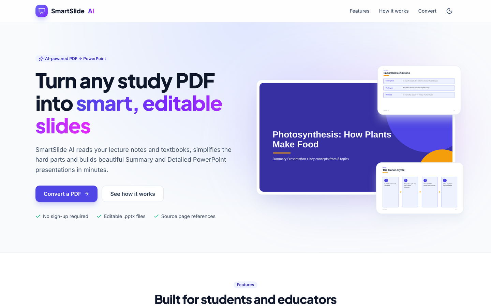
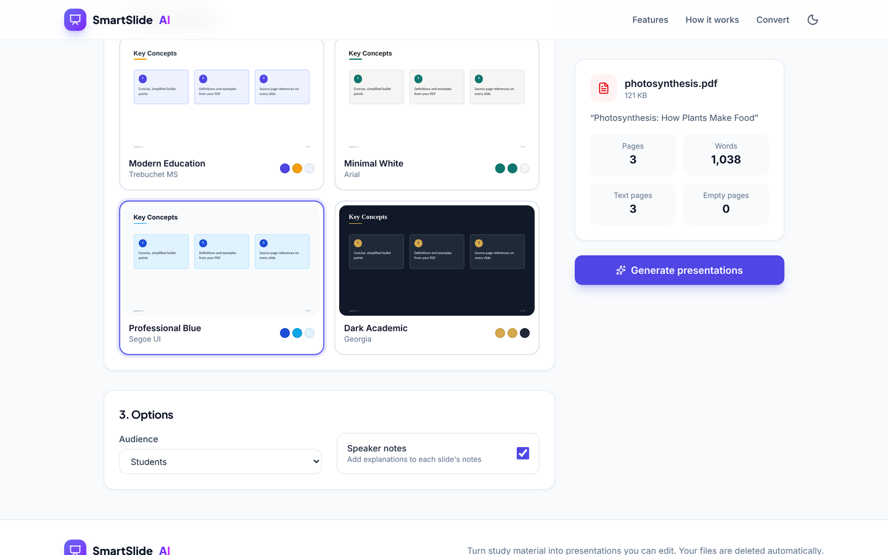
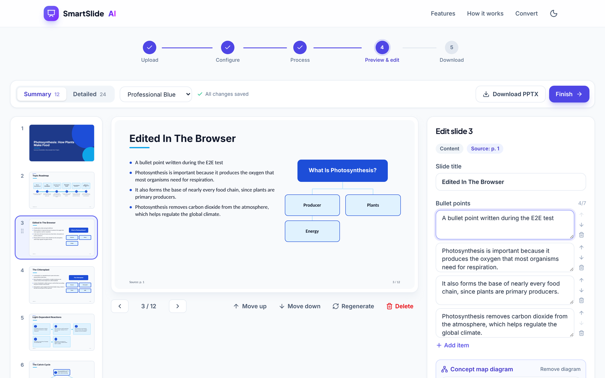
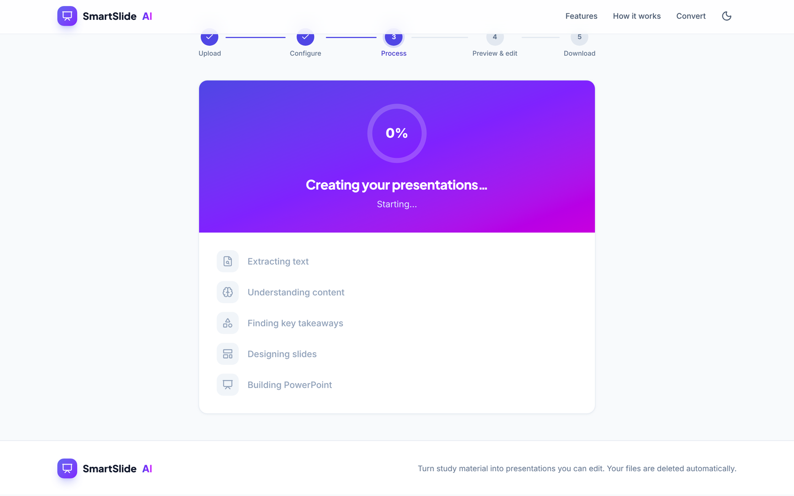
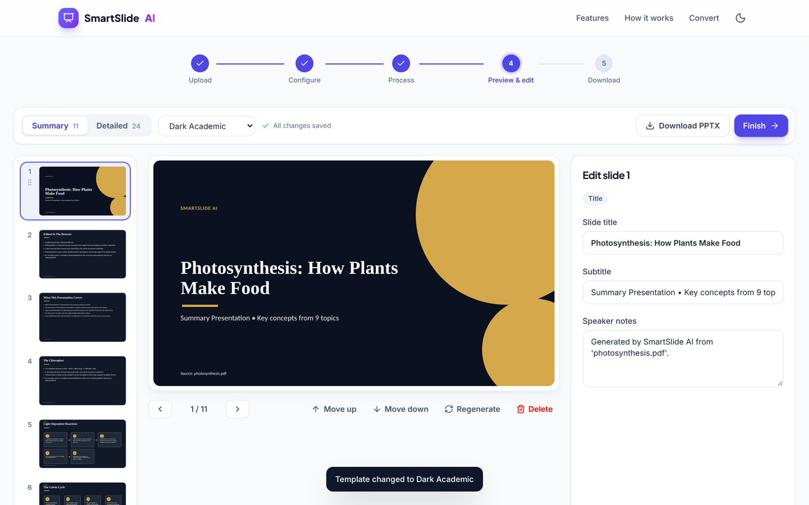

# SmartSlide AI: PDF to Smart PowerPoint Converter

**🚀 Live demo: https://smartslide-ai-amith25.vercel.app**

SmartSlide AI turns educational PDFs (lecture notes, textbook chapters, study guides) into clean,
**fully editable** PowerPoint presentations. From one upload it generates two decks:

| Deck | Default length | Purpose |
|------|----------------|---------|
| **Summary** | 10–15 slides (default 12) | Key concepts, simplified bullets, definitions and takeaways |
| **Detailed** | 20–30 slides (default 24) | Topic-by-topic coverage with explanations, examples, processes and comparisons |

Slides are built from native PowerPoint text boxes, shapes, tables and diagrams, never page screenshots.
Every slide cites the PDF pages it came from.



| Configure | Preview & edit |
|---|---|
|  |  |
|  |  |

## Features

- **Upload and validation:** drag-and-drop upload. Rejects non-PDF, corrupted, password-protected, oversized (25 MB) and over-long (300 pages) files with clear messages.
- **Extraction:** page-wise text extraction (PyMuPDF), heading detection from font sizes, removal of running headers and footers, hyphenation and ligature repair.
- **Scanned PDFs:** automatic detection plus **Tesseract OCR** fallback. Empty or unreadable pages are reported, never silently dropped.
- **AI pipeline:** topic-aware chunking for long documents, structured JSON output validated with Pydantic, an automatic retry on invalid JSON, and a grounding pass that removes ungrounded definitions and invalid page references.
- **Pluggable AI providers:** Claude, Gemini, or an offline **demo mode** that needs no API key. Demo mode is also the automatic fallback when an API is unavailable.
- **Visual diagrams:** a topic roadmap (timeline), a Big Picture concept map, concept maps of each topic's key terms beside the bullets, and cycle diagrams for processes that loop (e.g. the Calvin cycle). All are native, editable PowerPoint shapes and connectors, and can be edited in the preview.
- **PowerPoint generation:** 4 templates (Modern Education, Minimal White, Professional Blue, Dark Academic) and 9 slide layouts (title, section, content, definition, comparison table, process flow, examples, key takeaways, conclusion). Includes slide numbers, source references and speaker notes.
- **Preview editor:** navigate slides, edit titles, bullets, definitions, steps, comparisons and notes (autosaved). Reorder by drag-and-drop or buttons, add, delete or regenerate slides, and switch templates. Downloads always reflect your edits.
- **Security:** files are stored under random IDs (never user filenames) and are not publicly served. Includes size limits, a CORS allow-list, and automatic cleanup after 24 hours. API keys stay on the server.
- **Light and dark themes**, with a responsive layout for desktop and mobile.

## Quick start

Prerequisites: **Python 3.11+**, **Node.js 20+**, and optionally **Tesseract OCR** for scanned PDFs.

```bash
git clone <your-repo-url> SmartSlide-AI
```

```bash
cd SmartSlide-AI/backend && python3 -m venv .venv && . .venv/bin/activate && pip install -r requirements-dev.txt && cp .env.example .env
```

```bash
uvicorn app.main:app --reload --port 8000
```

In a second terminal:

```bash
cd SmartSlide-AI/frontend && npm install && cp .env.example .env && npm run dev
```

Open **http://localhost:5173**. Demo mode works immediately without an API key. Try it with
`backend/samples/photosynthesis.pdf`.

Interactive API docs: http://localhost:8000/docs

## Enabling Claude or Gemini

Edit `backend/.env` (never commit it):

```ini
AI_PROVIDER=claude          # or gemini
ANTHROPIC_API_KEY=sk-ant-...   # for Claude
GEMINI_API_KEY=...             # for Gemini
```

Restart the backend. Keys are read only on the server and are never sent to the browser. If a key is
missing or the API fails, SmartSlide AI uses the offline engine and shows a notice on the preview page.

## Tests

```bash
cd backend && . .venv/bin/activate && pytest
```

```bash
cd frontend && npm run lint && npm run build
```

End-to-end browser test (needs both servers running and Playwright installed):

```bash
node scripts/e2e_smoke.cjs backend/samples/photosynthesis.pdf
```

## Documentation

- [Installation & development setup](docs/INSTALLATION.md)
- [Architecture](docs/ARCHITECTURE.md)
- [API reference](docs/API.md)
- [GitHub setup](docs/GITHUB.md)
- [Deploying to Vercel](docs/DEPLOY_VERCEL.md)

## Project structure

```
SmartSlide-AI/
├── backend/
│   ├── app/
│   │   ├── main.py            # FastAPI app, CORS, error handlers, lifespan
│   │   ├── config.py          # environment-based settings
│   │   ├── database.py        # SQLAlchemy / SQLite
│   │   ├── models.py          # Document, Job, Presentation
│   │   ├── schemas.py         # Pydantic: slides, AI output, API payloads
│   │   ├── routes/            # health, documents, jobs, presentations
│   │   ├── services/
│   │   │   ├── pdf_extractor.py    # validation, extraction, OCR
│   │   │   ├── chunker.py          # topic-aware chunking
│   │   │   ├── ai/                 # provider abstraction: claude, gemini, mock, factory, prompts
│   │   │   ├── content_processor.py# topics -> Summary / Detailed decks
│   │   │   ├── templates.py        # 4 themes
│   │   │   ├── pptx_builder.py     # python-pptx renderer
│   │   │   ├── jobs.py             # background conversion pipeline
│   │   │   ├── storage.py, cleanup.py
│   │   └── utils/             # safe filenames, text helpers
│   ├── tests/                 # pytest suite
│   ├── scripts/make_sample_pdf.py
│   └── samples/               # sample PDFs (text, scanned, empty)
├── frontend/
│   └── src/
│       ├── pages/             # Landing, Upload, Configure, Processing, Preview, Download
│       ├── components/        # Layout, Stepper, SlideCanvas, SlideEditor, UI kit
│       ├── services/api.js    # Axios API client
│       ├── context/, hooks/, utils/
├── scripts/e2e_smoke.cjs      # Playwright end-to-end test
└── docs/
```

## License

MIT
